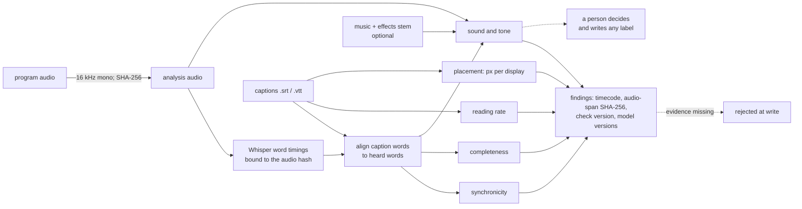

# captioncheck

Caption and subtitle QC that reads like a Deaf viewer.

captioncheck checks a caption file (SRT or WebVTT) against the program's audio
and the words a speech model heard in it. It reports captions that come late
or leave early, speech with no caption on screen, cues too fast to read, lines
too wide for the screen they'll be read on, and sounds or shouted lines that
no caption mentions. The check names follow the caption-quality terms in the
FCC's rule (47 CFR 79.1(j)(2)): synchronicity, completeness, placement and
accuracy. captioncheck doesn't certify compliance with that rule or any other.

Two rules shape all of it:

- **Every finding carries its evidence.** That means the timecode, the SHA-256 of
  the audio samples in that span, the check and its version, and the version of
  every model it rests on. A finding missing any of these is rejected when it's
  written, and a transcript made from different audio is refused outright.
- **Sound and tone go to a person.** captioncheck flags a loud sound that no
  caption labels, and a line spoken far louder or quieter than usual with
  nothing marking it. It never writes the label itself.

## What it checks

| Check | Catches | Measured against | Result |
| --- | --- | --- | --- |
| `synchronicity.late_start` | caption appears after the words start | Whisper word timings | fail |
| `synchronicity.early_start` | caption appears well before anyone speaks | Whisper word timings | fail |
| `synchronicity.early_end` | caption leaves before the line is finished | Whisper word timings | fail |
| `synchronicity.drift` | offset that grows steadily, as with timings made for another frame rate | Theil-Sen slope of offsets | fail |
| `synchronicity.unmatched_cue` | caption words that weren't heard near it (on-screen text, a mishearing, or far out of sync) | alignment | review |
| `synchronicity.reading_rate` | too many characters for the time on screen | characters per second | fail |
| `completeness.uncaptioned_speech` | speech while no caption is on screen | Whisper word timings | fail, or review when the model is unsure |
| `placement.line_width` | a line wider than the screen area captions may use | glyph advance widths in px, per display | fail |
| `placement.line_count` | more lines than the display allows, once wrapped | same | fail |
| `accuracy.unlabelled_sound` | a loud sound with no label near it | music-and-effects stem, or the mix outside speech | review |
| `accuracy.unmarked_tone` | a line far louder or quieter than usual, with no `!` or label | line loudness vs the program's typical line | review |

A run is `pass`, `fail`, `review` or `unverified`. It's `unverified`, never
`pass`, when too few caption words were heard in the audio. That happens with
the wrong audio, the wrong program start, or a model that never heard the media.

**Line width is in pixels, not characters.** "42 characters per line" is a
character count, but a viewer sees pixels. In Arial-metric type, `WWWWW` is
more than four times as wide as `iiiii`. captioncheck adds up each glyph's
measured advance width (Liberation Sans, metric-compatible with Arial) at the
display's caption size. It then compares the total with the part of the
screen captions may use. A line that fits a TV can wrap to three lines on a
phone where the reader has turned the caption size up.

| Display | Width | Usable | Type | Lines |
| --- | --- | --- | --- | --- |
| `tv-1080p` | 1920 px | 80% | 54 px | 2 |
| `phone-large` | 390 px | 90% | 18 px | 2 |
| `hud-488` | 488 px | 85% | 21 px | 5 |

These sizes are stated assumptions, not a spec. Add your own in a TOML file
(see `thresholds.example.toml`).

## How it works



Caption words are aligned in order to the heard words within a ±4 s window.
Exact matches count as heard. Short runs of different words in the same place
still time the cue but don't count as heard (the film's "Thom" is heard as
"Tom"). Whisper often stretches a word that comes before a pause well into the
silence. So when a span of speech ends, each word counts for at most 0.5 s,
about twice the median word length in the recorded transcripts.

## Every finding carries its evidence

One line of `--jsonl` output, from the planted "dropped line" defect below
(shortened):

```json
{
  "check": "completeness.uncaptioned_speech", "check_version": 1, "disposition": "fail",
  "timecode": {"in": "00:00:27:08", "out": "00:00:29:21", "start_s": 27.34, "end_s": 29.88},
  "message": "Speech with no caption on screen for 2.54 s. The speech model heard \"You have your robotics and I just want to be awesome in space.\" (13 words). A Deaf viewer gets nothing here.",
  "measured": {"words": 13, "mean_word_p": 0.933, "level_dbfs": -20.3},
  "evidence": {
    "audio_span_sha256": "7cda6e6b80a58ccf9c50f273bf08324ff12b13d5f1033e70f2eeaf9fea357d90",
    "audio_sha256": "1cbf7dfd0213d4286c378ea9d535337f86c30e90bd48286ab5b7219818bfd99d",
    "captions_sha256": "bb83e151...", "me_sha256": "f5e00f5b...", "config_sha256": "4edb973c...",
    "run_models": [{"kind": "speech", "id": "faster-whisper:small.en", "version": "d1d751a5f8271d482d14ca55d9e2deeebbae577f"},
                   {"kind": "glyphs", "id": "glyphs:liberation-sans-regular", "version": "15212920f603382e"}]
  },
  "models": [{"kind": "speech", "id": "faster-whisper:small.en", "version": "d1d751a5f8271d482d14ca55d9e2deeebbae577f"}]
}
```

The analysis audio comes from an integer-only downmix and decimation, so the
same input gives the same samples, and the same span hashes, on any machine.
A test pins that bit for bit.

## Try it

```sh
pip install ".[test]"
python scripts/fetch_clips.py          # about 63 MB of byte ranges; every SHA-256 is checked
captioncheck check clips/cache/TOS-en.srt \
  --audio clips/cache/set.mix.wav --me clips/cache/set.me.wav --start 336 \
  --words tests/fixtures/words/set.small.en.json --jsonl findings.jsonl --fps 24
python scripts/plant_defects.py        # writes clips/cache/planted/*.srt, one defect each
```

To run the speech model yourself, install `".[whisper]"` and leave out
`--words`. The model is fetched once and works offline after that
(`--offline`). `captioncheck transcribe AUDIO -o words.json` records a
transcript that later runs can reuse. Exit status: 0 pass, 1 fail, 2 review
only, 3 unverified or refused.

## The clips

Two segments of *Tears of Steel* (CC BY 3.0, Blender Foundation): the bridge
argument (0:20–1:06) and the film set (5:36–6:40). Blender publishes the
film's stereo mix and its music-and-effects stem as uncompressed 24-bit AIFF,
so each clip is an exact byte range. Nothing decodes the download before
captioncheck's own integer downmix, and `clips/manifest.json` pins the
SHA-256 of every byte range, every analysis WAV and the official English
subtitles. Nothing from the film is committed except the speech model's
transcript of its dialogue, in `tests/fixtures/words/`.

The two stems are on the same timeline (their loudness envelopes line up at
0 ± 10 ms), but they're different mixes, so one can't be subtracted from the
other to isolate dialogue. captioncheck uses the stem only for where music and
effects get loud.

## What was tested

81 tests (pytest) cover the following:

- **Unit and synthetic tests (68), no network and no model.** These cover caption
  parsing, the bit-exact audio path, glyph measurement, write-time rejection of
  findings without evidence, calibration, the CLI, and every check on a
  synthetic program. In that program a clean caption file must pass with zero
  findings, and each single defect must produce exactly the right finding.
- **Golden tests on the real clips (11), with recorded Whisper timings.**
  Every pinned hash matches, and each planted defect is caught where it was
  planted and wasn't already flagged in the reference.
- **Live speech model (2), optional.** These run Whisper small.en offline on
  both clips. The run must agree with the recordings (at least 90% of tokens in
  sequence, median start-time difference at most 0.1 s), and every plant must
  still be caught on the live timings.

All 81 passed on 2026-11-01 on Python 3.12, live tests included. The unit and
golden tests also passed on Python 3.11, installed from `pyproject.toml` into
a fresh environment. Two transcriptions of each clip on the same machine
produced identical files. CI (`.github/workflows/ci.yml`) runs the unit tests
on Python 3.11 and 3.13, then fetches the clips and runs the golden tests. The
live-model job runs only when started by hand.

| Planted defect | Expected finding | Caught |
| --- | --- | --- |
| a line deleted (bridge cue 3; set cue 47) | `completeness.uncaptioned_speech` over that speech | yes |
| two cues shifted 0.8 s late | `synchronicity.late_start` on both | yes |
| two cues crammed into one cue's time | `synchronicity.reading_rate`, `synchronicity.early_end` | yes |
| a two-line cue joined into one line | `placement.line_width` on `phone-large` and `tv-1080p` | yes |
| timings scaled by 25/24 | `synchronicity.drift` | yes |
| a person adds a sound label | the `accuracy.unlabelled_sound` flag there clears | yes |

## What it reported on the official subtitles

These are leads for a person. Nobody has listened to confirm them yet.

- **Bridge:** 4 cues over 20 characters per second. Cue 8, "...by these giant
  robotic claws of death...", is 43 characters in 1.00 s. Cue 11 appears 0.68 s
  after the line starts. Cue 9 mixes on-screen text ("Fourty years later") into
  a line of dialogue, so only 3 of its 7 words were heard.
- **Film set:** cue 48, "Why does he do this?", appears 1.16 s after the
  line starts. A repeated "Two minutes." is spoken with no caption on screen.
  Whisper also heard "Come on!" in a gap, but with low confidence, so that one
  went to review.
- **Neither segment** had a placement finding or a tone flag. The loudest
  unmarked line, "You broke my heart.", was 7.7 dB above typical, and the flag
  starts at 8 dB.
- **Each segment** had 3 loud sounds with no label. That's expected: these are
  subtitles for hearing viewers, so they carry no sound labels at all.

## Thresholds

| Setting | Default | Where it comes from |
| --- | --- | --- |
| `reading.max_cps` | 20 | Netflix English (USA) Timed Text Style Guide, adult programs (17 for children's) |
| `sync.late_start_s` | 0.5 s | engineering default |
| `sync.early_start_s` | 1.0 s | engineering default |
| `sync.early_end_s` | 0.5 s | engineering default |
| `sync.word_cap_s` | 0.5 s | about twice the median word length in the recorded transcripts |
| `completeness.min_words` | 2 | engineering default |
| `sound.rise_db` / `sound.min_dbfs` | 10 dB / -30 dBFS | engineering default |
| `tone.raised_db` / `tone.quiet_db` | +8 / -12 dB | engineering default |

**None of these comes from a Deaf viewer's grades yet.** The plan to get them,
and the code that turns grades into this file, are in
[docs/GRADING-PLAN.md](docs/GRADING-PLAN.md) and `captioncheck calibrate`.
Grades are kept per reader group, and the strictest group sets the default.
The sync thresholds also absorb Whisper's own timing error, so they hold for
this model revision only.

## What it does not do

- It doesn't write captions, sound labels or manner labels.
- It doesn't hear sarcasm, emotion or who is speaking. It has no video, so it
  can't see faces, burned-in text or where captions sit on the picture.
- It doesn't score word accuracy. Whisper's hearing is evidence, not ground
  truth.
- It has been tested on two clips from one public film. It hasn't been used
  on a production caption pipeline, and nothing here measures its precision
  or speed.

## Why I built this

My brother and stepdad are Deaf, and my mom is an interpreter. In fall 2025,
the interpreter my stepdad had asked for didn't show at my siblings'
back-to-school night. I put on-device captions on his phone in airplane mode,
and he read every teacher. On Dec 7, 2025, at the xAI hackathon, I added
sarcasm alerts to live captions, because a caption says what was said, not how
it was said. On Dec 26, 2025, I had captions from the phone's mic on a pair
of glasses with a 488 px display, refreshed every 500 ms with a 60-character
window. By April 2026 the refresh was 250 ms, and lines wrapped by each
glyph's width, because characters aren't pixels. In October 2026 I timed the
captions on my Demo Derby talk video to a local Whisper transcript, and every
on-screen claim in that video carries its source.

Each of those taught me one of these checks. The reviewer who would catch a
missing line can't hear it. A line has to fit the screen it's read on. Tone
needs a person. A finding needs its evidence. I haven't worked on a
streamer's caption pipeline. captioncheck is these checks, run on public
footage, written so a Deaf reviewer's grades can replace my defaults.

## Credits and licence

MIT, (c) 2026 Jacob Lopez. See [NOTICE](NOTICE) for the film, the font
metrics and the style guide this repository draws on.
